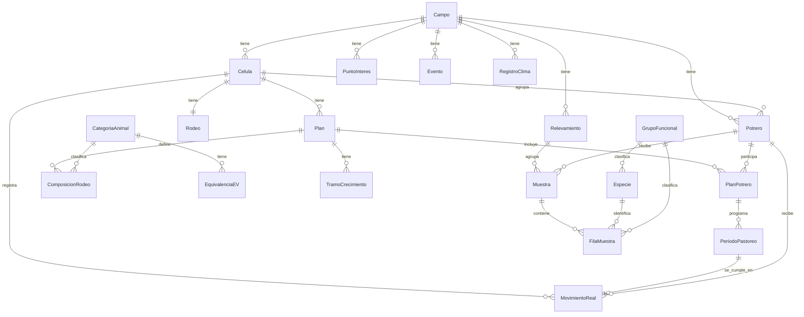

# SPEC — HOLOS v1

App de manejo holístico del pastoreo y monitoreo ambiental.

Este documento es autosuficiente: quien construya la app no necesita el Excel de origen ni ninguna otra fuente. Todo lo que el Excel hacía mal está corregido acá; los casos de prueba (sección 7) usan los números reales del Excel con el resultado esperado según estas reglas.

**Convenciones del documento**

- Los números usan punto decimal (formato de código). La interfaz muestra coma decimal (es-AR).
- Fechas en ISO `YYYY-MM-DD`. Un **instante** es un par (fecha, turno) con turno `AM` o `PM`; `AM` es el inicio del día y `PM` la mitad.
- Los cálculos se hacen con precisión completa; solo se redondea donde una regla lo dice. Las comparaciones usan tolerancia `EPS = 1e-9`.
- Cada regla tiene un ID (`CM-`, `PA-`, `PC-`, `CA-`, `RG-`, `MO-`, `MP-`). Los casos de prueba citan esos IDs.
- "Debe" indica requisito obligatorio de la v1.

---

## 1. Objetivo

HOLOS permite a un productor planificar, ejecutar y evaluar el pastoreo de su campo con el método de Planificación Holística del Pastoreo (Savory), y registrar el estado de la vegetación, desde un teléfono o tablet y sin conexión.

La v1 debe permitir:

1. Dibujar los potreros del campo sobre un mapa y conocer su superficie.
2. Armar un **plan abierto** (estación de crecimiento): calcular cuánto tiempo pasa el rodeo en cada potrero para que cada uno reciba el tiempo de recuperación que necesita.
3. Armar un **plan cerrado** (estación sin crecimiento): repartir los días según el pasto disponible en cada potrero y avisar si el pasto alcanza para el rodeo, con reserva de sequía.
4. Registrar los movimientos reales del rodeo y compararlos con el plan.
5. Registrar muestras de cobertura vegetal por potrero y ver su evolución.

Usuario: el productor o encargado, en el campo, con una sola mano libre y a menudo sin señal. Principios de diseño: simple, intuitiva y con identidad propia (no una plantilla genérica de panel de administración); pocos datos por pantalla; botones grandes; todo cálculo visible con su explicación.

Alcance de la v1: un campo, una célula, un rodeo. El modelo de datos ya contempla varias células, cada una con su rodeo y su circuito.

---

## 2. Glosario

| Término | Definición |
|---|---|
| Campo | Establecimiento. Contiene potreros y células. |
| Célula | Conjunto de potreros que recorre un rodeo. Cada célula tiene un único rodeo y su propio plan. |
| Potrero | Unidad de pastoreo delimitada. Tiene superficie en hectáreas (ha). |
| Rodeo | Grupo de animales que se mueve junto. Su tamaño se expresa en EV. |
| EV (equivalente vaca) | Unidad de consumo. Cada categoría animal vale una fracción de EV según su peso y estado fisiológico (una oveja madre de 40 kg = 0.16 EV). |
| DA (día animal, ración) | Lo que consume 1 EV en 1 día. Unidad común para oferta y demanda de pasto. |
| Plan abierto | Plan de la estación de crecimiento. Su variable crítica es el tiempo de recuperación. |
| Plan cerrado | Plan de la estación sin crecimiento. Raciona el pasto existente hasta una fecha fija; su variable crítica es el balance entre oferta y demanda. |
| TR (tiempo de recuperación) | Días que una planta pastoreada necesita para reponerse. Se carga un mínimo (crecimiento rápido) y un máximo (crecimiento lento). |
| TP (tiempo de pastoreo) | Días que el rodeo permanece en un potrero en una pasada. |
| PP (período de pastoreo promedio) | TP que le correspondería a un potrero promedio. |
| Vuelta | Recorrido completo de todos los potreros del plan abierto. |
| Selección | Cada pasada completa por los potreros en el plan cerrado. Con 2 selecciones, cada potrero se pastorea 2 veces. |
| Calidad relativa | Puntaje subjetivo de 1 a 10 que el productor asigna a cada potrero en el plan abierto; 10 es el mejor. Estima cuánto rodeo puede sostener el potrero por hectárea. |
| Calidad ponderada | Superficie × calidad relativa. |
| Factor relativo | Calidad ponderada del potrero dividida por la calidad ponderada promedio. 1 = potrero promedio. |
| Tasa de crecimiento | Estado del pasto que carga el productor: `rapida`, `lenta` o `nula`. Decide si se usa el TP mínimo o el máximo. |
| Disponibilidad | Pasto en pie de un potrero, en kg de materia seca por hectárea (kg MS/ha). Dato del plan cerrado. |
| Asignación | kg MS de pasto en pie que se reservan por cada DA. Valor por defecto: 20. Bajarla da más raciones (se come más y queda menos remanente). |
| DAT | Raciones totales de un potrero (DA). |
| Oferta | Suma de las DAT de los potreros del plan (DA). |
| Demanda | DA que consume el rodeo durante los días requeridos. |
| Reserva de sequía | Días que se agregan a la duración del plan cerrado por si el crecimiento empieza tarde. |
| Días requeridos | Días del plan cerrado + días de reserva de sequía. |
| Receptividad | EV que la oferta puede sostener durante los días requeridos. |
| Carga animal | EV del rodeo dividido por la superficie de la célula (EV/ha). |
| Densidad | EV del rodeo dividido por la superficie del potrero que ocupa (EV/ha). |
| Movimiento | Cambio real del rodeo de un potrero a otro. |
| Relevamiento | Salida de monitoreo en una fecha. Agrupa muestras. |
| Muestra | Observación de cobertura vegetal en un punto de un potrero. |
| Grupo funcional | Categoría de vegetación o de suelo usada en el monitoreo. |
| EOV | Ecological Outcome Verification, método de monitoreo del Savory Institute con matrices por ecosistema. Fuera de la v1 (sección 9). |

---

## 3. Módulos

Navegación principal con cinco entradas: **Hoy**, **Mapa**, **Plan**, **Registro**, **Monitoreo**. Ajustes se abre desde Hoy.

### 3.0 Hoy

Pantalla de inicio. Muestra, para el plan activo:

- Potrero donde está el rodeo, hace cuántos días entró y cuántos le quedan según el plan.
- Próximo movimiento planificado (potrero y fecha) y botón **Mover rodeo**.
- Alertas vigentes (sección 4.7).
- Tasa de crecimiento vigente, con acceso directo para cambiarla (solo plan abierto).

### 3.1 Mapa de potreros

Propósito: definir los potreros y ver el estado del campo de un vistazo.

Debe permitir:

- Dibujar un potrero tocando vértices sobre una imagen satelital; mover, agregar y borrar vértices; nombrarlo.
- Calcular la superficie del polígono (CM-03) y permitir una superficie declarada que la reemplaza.
- Importar y exportar potreros en GeoJSON y KML.
- Mostrar la posición GPS del dispositivo.
- Mostrar sobre cada potrero una etiqueta con su nombre, su superficie y sus días de pastoreo mínimos y máximos según el plan elegido (MP-01). Por defecto se usa el plan activo; un selector permite ver un plan en borrador.
- Colorear cada potrero según su estado (RG-06) y, al tocarlo, mostrar una ficha: superficie, días de pastoreo mínimos y máximos (calculados y redondeados), recuperación prevista, último pastoreo, días de descanso, próxima entrada planificada, último relevamiento.
- Marcar puntos de interés (aguada, tranquera, corral, otro).
- Funcionar sin conexión: los potreros siempre se ven; la imagen de fondo se ve si fue guardada antes (sección 8.1).

Criterios de aceptación: un potrero no se puede guardar sin nombre ni con menos de 3 vértices; dos potreros del mismo campo no pueden llamarse igual; la superficie se muestra con 2 decimales; los días de la etiqueta coinciden siempre con los de la tabla del plan y se actualizan al cambiar cualquier dato del plan.

### 3.2 Planificación abierta

Flujo:

1. **Datos del plan**: nombre, fecha de inicio y de fin (la app calcula los días, CM-01), TR mínimo y TR máximo en días, modo de recuperación (`garantizada` por defecto, o `curso`).
2. **Potreros**: elegir cuáles entran, asignar calidad relativa (1 a 10, entero) y ordenar la secuencia arrastrando.
3. **Rodeo**: composición por mes (categoría, estado fisiológico, cantidad, peso promedio). La app completa el EV unitario desde la tabla de equivalencias (CM-04) y permite corregirlo a mano.
4. **Resultado**: tabla por potrero con factor relativo, TP mínimo y máximo (calculado y redondeado), recuperación prevista en cada caso (PA-08) y alertas. Resumen: duración de la vuelta rápida y lenta, carga animal, densidad máxima y mínima.
5. **Calendario**: línea de tiempo por potrero (una fila por potrero, eje horizontal de fechas, igual que la planilla Savory) generada con CA-02. Encima se dibujan los eventos.

Durante el plan, el productor cambia la tasa de crecimiento cuando lo decide (PA-10); la app recalcula el calendario desde esa fecha (CA-06).

Criterios de aceptación: el plan necesita al menos 2 potreros incluidos; con modo `garantizada` ningún potrero puede quedar con recuperación prevista menor al TR; cada número de la tabla muestra su fórmula al tocarlo.

### 3.3 Planificación cerrada

Flujo:

1. **Datos del plan**: nombre, fechas, número de selecciones (1 a 3), días de reserva de sequía, asignación (kg MS por DA, por defecto 20).
2. **Potreros**: elegir cuáles entran, cargar la disponibilidad (kg MS/ha) de cada uno y ordenar la secuencia.
3. **Rodeo**: igual que en el plan abierto.
4. **Balance**: oferta, demanda, balance, receptividad, días cubiertos y estado (`deficit`, `equilibrado`, `excedente`), con PC-07 a PC-10. La app avisa; el productor ajusta carga, tiempos, asignación o suplementación hasta que cierre.
5. **Resultado y calendario**: tabla por potrero con DA/ha, DAT, TP por selección (calculado y redondeado), demanda planeada y utilización; calendario generado con CA-03. Los días de reserva se muestran como una franja al final.

Criterios de aceptación: un potrero con disponibilidad 0 o vacía queda fuera de la secuencia con el aviso "sin pasto cargado"; el balance se recalcula al cambiar cualquier dato; la app no bloquea un plan en déficit, solo avisa.

### 3.4 Registro plan vs. real

Flujo:

- **Mover rodeo**: elige potrero de destino (propone el próximo del plan), fecha y turno (propone ahora) y observaciones opcionales. Al guardar se cierra el movimiento anterior y se abre el nuevo (RG-01).
- **Historial**: lista de movimientos con días reales, días planificados y desvío (RG-02, RG-03).
- **Calendario comparado**: la misma línea de tiempo del plan con dos trazos por potrero: planificado y real.
- **Recuperación**: por potrero, días de descanso reales entre pastoreos y si cumplieron el TR (RG-04).
- **Cosecha**: DA y DA/ha cosechados por potrero (RG-05) y, en plan cerrado, utilización real (RG-07).
- **Clima**: carga rápida de lluvia (mm) y nieve (cm) por fecha.
- **Eventos**: parición, esquila, servicio, destete, sanidad, potrero no disponible, otro; con fechas, potreros afectados y si bloquean el pastoreo.
- **Replanificar**: regenera el calendario desde una fecha conservando lo ya ocurrido (CA-06).

Criterios de aceptación: nunca hay más de un movimiento abierto por célula; un movimiento no puede empezar antes que el anterior; se puede corregir o borrar un movimiento y todo lo derivado se recalcula.

### 3.5 Monitoreo ambiental

En la v1 reproduce el esquema del Excel corregido. Un **sector del Excel es un potrero**.

Flujo:

- **Nuevo relevamiento**: fecha (queda fija al guardar) y nombre opcional.
- **Nueva muestra**: potrero, número de muestra (correlativo dentro del relevamiento y el potrero), posición GPS y foto opcionales, y filas. Cada fila es una especie (nombre, cobertura %, grupo funcional, estacionalidad) o suelo desnudo (solo cobertura %).
- Al escribir una especie conocida, la app completa grupo funcional y estacionalidad desde el catálogo (MO-02). Las especies nuevas se agregan al catálogo.
- **Resumen por potrero**: promedio, desvío estándar y cantidad de muestras por grupo funcional (MO-03 a MO-05), con gráfico de barras con barra de error.
- **Evolución**: mismo gráfico comparando relevamientos del mismo potrero en el tiempo.

Grupos funcionales de la v1 (editables en Ajustes, porque van a cambiar cuando se incorpore EOV): Forrajeras de invierno, Forrajeras de verano, Leguminosas, Maleza de invierno, Maleza de verano, Suelo desnudo.

Criterios de aceptación: una fila sin cobertura no se guarda; la cobertura acepta de 0 a 100; la fecha de una muestra no cambia sola.

---

## 4. Reglas de cálculo

### 4.1 Comunes

**CM-01 — Días del plan.** `dias_plan = fecha_fin − fecha_inicio + 1` (ambas fechas incluidas).

**CM-02 — Meses del plan.** El plan se divide en meses calendario. `dias_mes` es la cantidad de días del plan que caen en ese mes (el primero y el último pueden ser parciales). La suma de `dias_mes` es `dias_plan`.

**CM-03 — Superficie del potrero.** `sup = superficie_declarada_ha` si está cargada; si no, `superficie_calculada_ha`, que es el área geodésica del polígono en WGS84, en hectáreas (m² / 10000), redondeada a 2 decimales. Al incluir un potrero en un plan se guarda una copia de `sup` en el plan.

**CM-04 — EV unitario.** Se busca en la tabla de equivalencias la fila con la misma categoría y el mismo estado fisiológico cuyo rango cumple `peso_min_kg ≤ peso_promedio_kg < peso_max_kg`. Si hay fila, `ev_unitario = ev` de esa fila. Si no hay, el campo queda vacío y el usuario debe cargarlo (`ev_manual = true`). El usuario siempre puede reemplazar el valor.

**CM-05 — EV del rodeo.** Por categoría: `ev_categoria = cantidad × ev_unitario`. Por mes: `ev_mes = Σ ev_categoria`. Cabezas del mes: `Σ cantidad`.

**CM-06 — EV del rodeo en una fecha.** Es el `ev_mes` del mes que contiene la fecha. Para fechas posteriores al fin del plan (reserva de sequía) se usa el último mes del plan. Si un mes no tiene composición cargada se usa la del mes anterior más cercano.

**CM-07 — Carga animal.** `carga = ev_mes / sup_celula`, en EV/ha, donde `sup_celula = Σ sup` de los potreros incluidos en el plan. También se muestra la inversa `sup_celula / ev_mes` en ha/EV.

**CM-08 — Densidad.** `densidad_i = ev_rodeo / sup_i`, en EV/ha. También en cabezas/ha.

**CM-09 — Redondeo del tiempo de pastoreo.** Dado un TP calculado `x` en días:

| Condición | TP redondeado |
|---|---|
| `x ≤ EPS` | 0 |
| `EPS < x ≤ 0.5` | 0.5 |
| `0.5 < x ≤ 1` | 1 |
| `x > 1` | entero inmediato superior (`ceil`); si `x` ya es entero, queda igual |

Ejemplos: 14.4 → 15; 0.4 → 0.5; 0.81 → 1; 12.0 → 12. El calendario siempre usa el TP redondeado. La app muestra ambos valores.

**CM-10 — Diferencia entre instantes.** `dias(A, B) = (fecha_B − fecha_A) + (0.5 si turno_B = PM) − (0.5 si turno_A = PM)`.

### 4.2 Plan abierto

Entradas por potrero incluido: `sup_i` (ha), `cal_i` (1 a 10). Entradas del plan: `TRmin`, `TRmax` (días, `TRmin ≤ TRmax`), `modo_recuperacion`.

**PA-01 — Calidad ponderada.** `CP_i = sup_i × cal_i`.

**PA-02 — Cantidad de potreros.** `n` = cantidad de potreros incluidos. Se calcula, nunca se tipea. Debe ser `n ≥ 2`.

**PA-03 — Calidad ponderada promedio.** `CPm = Σ CP_i / n`.

**PA-04 — Factor relativo.** `f_i = CP_i / CPm`. `f_max` es el mayor `f_i`.

**PA-05 — Período de pastoreo promedio.** Para un tiempo de recuperación `TR`:

- Modo `curso`: `PP(TR) = TR / (n − 1)`. Es el cálculo de la planilla original. Los potreros con `f_i > 1` descansan menos que `TR`.
- Modo `garantizada` (por defecto): `PP(TR) = TR / (n − f_max)`. Alarga la vuelta lo justo para que el potrero más exigido descanse exactamente `TR` y los demás, más.

**PA-06 — Tiempo de pastoreo del potrero.** `TPmin_i = f_i × PP(TRmin)` y `TPmax_i = f_i × PP(TRmax)`. Si el usuario cargó `tp_min_manual` o `tp_max_manual` en el potrero, ese valor reemplaza al calculado. Después se aplica CM-09.

**PA-07 — Duración de la vuelta.** `V(TR) = Σ TP_i(TR)`. Se informa la calculada (sin redondear, que vale `n × PP(TR)`) y la redondeada (suma de TP redondeados). El calendario usa la redondeada.

**PA-08 — Recuperación prevista.** `R_i(TR) = V(TR) − TP_i(TR)`, con valores redondeados. Si `R_i(TR) < TR` se emite la alerta AL-01.

**PA-09 — Indicadores de referencia del curso.** Con TP sin redondear: `TPtot_i = TPmin_i + TPmax_i`; `sin_animales_i = dias_plan − TPtot_i`; `pct_pastoreo_i = TPtot_i / dias_plan`. Suponen una pasada rápida y una lenta en el plan. Se muestran rotulados como "referencia"; el dato operativo es el calendario.

**PA-10 — Tasa de crecimiento y TP vigente.** El plan tiene una lista de tramos (fecha desde, tasa). La tasa vigente en una fecha es la del último tramo con `fecha_desde ≤ fecha`; si no hay tramos es `rapida`.

| Tasa | TR vigente | TP que se usa |
|---|---|---|
| `rapida` | `TRmin` | `TPmin_i` |
| `lenta` | `TRmax` | `TPmax_i` |
| `nula` | `TRmax` | `TPmax_i`, con alerta AL-08 |

**PA-11 — TR exigido a un descanso.** Para un descanso entre dos instantes, el TR exigido es el mayor TR vigente entre las tasas que rigieron en algún día de ese intervalo.

### 4.3 Plan cerrado

Entradas por potrero incluido: `sup_i` (ha), `disp_i` (kg MS/ha). Entradas del plan: `a` asignación (kg MS/DA, > 0), `s` selecciones (1 a 3), `dias_reserva` (≥ 0), `tolerancia_balance_pct` (por defecto 5).

**PC-01 — Forraje del potrero.** `F_i = sup_i × disp_i` (kg MS).

**PC-02 — Raciones por hectárea.** `DAha_i = disp_i / a` (DA/ha).

**PC-03 — Raciones totales del potrero.** `DAT_i = F_i / a` (DA).

**PC-04 — Oferta.** `oferta = Σ DAT_i` (DA). `n` = cantidad de potreros con `DAT_i > 0`. Promedios del campo: `DAha_campo = oferta / Σ sup_i` y `disp_campo = Σ F_i / Σ sup_i` (ponderados por superficie, sobre todos los potreros incluidos).

**PC-05 — Días requeridos.** `dias_requeridos = dias_plan + dias_reserva`.

**PC-06 — Tiempo de pastoreo.** Total del potrero: `TP_i = (DAT_i / oferta) × dias_requeridos`. Por selección: `TPsel_i = TP_i / s`. Si el usuario cargó `tp_manual`, reemplaza a `TPsel_i`. Después se aplica CM-09 a `TPsel_i`. La suma de `TP_i` sin redondear es `dias_requeridos`.

**PC-07 — Demanda.** `demanda = Σ_meses (ev_mes × dias_mes) + ev_ultimo_mes × dias_reserva` (DA).

**PC-08 — Balance.** `balance = oferta − demanda` (DA). `utilizacion_pct = demanda / oferta × 100`. Estado:

| Condición | Estado | Alerta |
|---|---|---|
| `demanda = 0` | `sin_demanda` | — |
| `balance < −tolerancia × demanda / 100` | `deficit` | AL-03 |
| `balance > tolerancia × demanda / 100` | `excedente` | AL-04 |
| en otro caso | `equilibrado` | — |

**PC-09 — Receptividad.** `receptividad = oferta / dias_requeridos` (EV).

**PC-10 — Días cubiertos.** `ev_promedio = demanda / dias_requeridos`; `dias_cubiertos = oferta / ev_promedio` (días). Dice cuántos días alcanza el pasto con el rodeo cargado.

**PC-11 — Demanda planeada por potrero.** Para cada período planificado: `demanda_i = ev_rodeo(fecha_entrada) × duracion_dias`; `demanda_DAha_i = demanda_i / sup_i`; `utilizacion_i = Σ demanda_i / DAT_i × 100` (sumando las selecciones).

### 4.4 Calendario

**CA-01 — Secuencia.** Cada potrero incluido tiene un `orden` (1, 2, 3…) único dentro del plan. El calendario recorre los potreros en ese orden.

**CA-02 — Generación en plan abierto.**

1. `t` = instante inicial (por defecto `fecha_inicio`, `AM`). `fin` = (`fecha_fin` + 1 día, `AM`). `k` = primer potrero de la secuencia. `vuelta = 1`.
2. Si el potrero `k` está bloqueado en `t` (CA-04), se saltea sin consumir tiempo, se emite AL-09 y se pasa al siguiente.
3. Tasa = tasa vigente en la fecha de `t` (PA-10). `dur` = TP redondeado del potrero según esa tasa.
4. Se crea un período: potrero `k`, entrada `t`, duración `dur`, tasa aplicada, vuelta. La salida es `t + dur`. Si la salida supera `fin`, la duración se recorta a `dias(t, fin)` y se marca `recortado`.
5. `t` = salida. `k` = siguiente potrero; al pasar del último al primero, `vuelta += 1`.
6. Se repite desde 2 mientras `t < fin`. Si todos los potreros están bloqueados en `t`, se avanza `t` medio día.

**CA-03 — Generación en plan cerrado.**

1. `t` = instante inicial. `fin` = (`fecha_fin` + 1 día + `dias_reserva`, `AM`).
2. Para cada selección de 1 a `s`, se recorren en orden los potreros con `DAT_i > 0`.
3. Si el potrero está bloqueado en `t`, se manda al final de esa selección; si al llegar ahí sigue bloqueado, se omite en esa selección con AL-09.
4. `dur` = `TPsel_i` redondeado. Se crea el período con `numero_seleccion`. Si la salida supera `fin`, se recorta y se marca `recortado`; los potreros que quedan sin entrar se listan en AL-05.
5. `t` = salida.

Los períodos cuya entrada es posterior a `fecha_fin` se dibujan dentro de la franja de reserva.

**CA-04 — Potrero bloqueado.** Un potrero está bloqueado en un instante si existe un evento con `bloquea_pastoreo = true`, que lo incluye, y cuya fecha cae entre `fecha_desde` y `fecha_hasta` del evento.

**CA-05 — Edición manual.** El usuario puede cambiar la duración de un período planificado (múltiplos de 0.5). El período queda `editado_manual = true` y los posteriores se corren para quedar encadenados (la entrada de cada uno es la salida del anterior). "Regenerar" pide confirmación y descarta las ediciones manuales desde la fecha elegida.

**CA-06 — Replanificación.** Al replanificar desde un instante `T` (o al cambiar la tasa de crecimiento, con `T` = fecha del cambio):

1. Los períodos vigentes con entrada `≥ T` pasan a `vigente = false`.
2. Si un período vigente contiene a `T`, se conserva sin cambios (su duración quedó fijada con la tasa vigente al entrar) y la generación empieza a su salida.
3. Se generan períodos nuevos con `version = version_calendario + 1` desde el potrero siguiente al último ocupado (según el movimiento real abierto, si existe; si no, según el plan).
4. `version_calendario` se incrementa. Los períodos no vigentes se conservan para consulta.

### 4.5 Registro

**RG-01 — Movimiento real.** Registrar una entrada a un potrero en el instante `E` cierra el movimiento abierto de la célula con salida `E` y crea uno nuevo abierto. Se guarda una copia de `ev_rodeo` y cabezas (CM-06) de la fecha de entrada. Si el potrero coincide con el del próximo período planificado vigente sin registrar, el movimiento se vincula a ese período; si no, queda sin vínculo ("no planificado").

**RG-02 — Días reales.** `dias_reales = dias(entrada, salida)`. Para el movimiento abierto, la salida es el instante actual.

**RG-03 — Desvío.** Para un movimiento vinculado: `desvio_dias = dias_reales − duracion_planificada`; `desvio_entrada = dias(entrada_planificada, entrada_real)`. Positivo = más largo o más tarde que el plan.

**RG-04 — Recuperación real.** Para dos movimientos consecutivos en el mismo potrero: `recuperacion = dias(salida_anterior, entrada_siguiente)`. Si el intervalo cae en un plan abierto y `recuperacion < TR exigido` (PA-11), se emite AL-02. Para el último pastoreo, la recuperación en curso es `dias(salida, ahora)`.

**RG-05 — Cosecha real.** `DA_cosechados = ev_rodeo × dias_reales`; `DAha_real = DA_cosechados / sup_i`. Por potrero y plan se acumulan todos sus movimientos.

**RG-06 — Estado del potrero (color en el mapa).**

| Estado | Condición |
|---|---|
| `ocupado` | Tiene el movimiento abierto de su célula. |
| `en_recuperacion` | Plan abierto activo, ya fue pastoreado y `dias(salida, ahora) < TR vigente`. Se muestra el avance `dias / TR`. |
| `recuperado` | Plan abierto activo, ya fue pastoreado y `dias(salida, ahora) ≥ TR vigente`. |
| `pastoreado` | Plan cerrado activo y ya recibió todas las selecciones planificadas. |
| `pendiente` | Está en el plan activo y no cumple ninguna de las anteriores. |
| `fuera_de_plan` | No está incluido en el plan activo. |
| `bloqueado` | Tiene un evento que bloquea el pastoreo hoy. Prevalece sobre los demás salvo `ocupado`. |

**RG-07 — Utilización real (plan cerrado).** `utilizacion_real_i = Σ DA_cosechados_i / DAT_i × 100`.

### 4.6 Monitoreo

**MO-01 — Fila válida.** Una fila es válida si tiene cobertura entre 0 y 100 y grupo funcional. Las filas de tipo `especie` necesitan además nombre; la estacionalidad (`perenne` o `anual`) es opcional. Las filas de tipo `suelo_desnudo` no llevan especie ni estacionalidad y pertenecen al grupo marcado como suelo desnudo.

**MO-02 — Catálogo de especies.** `clave_normalizada` = nombre en minúsculas, sin espacios al inicio ni al final, sin tildes y con espacios internos colapsados. Si la clave existe en el catálogo, se proponen su grupo funcional y su estacionalidad. Si no existe, al guardar la muestra se crea la especie con los datos cargados.

**MO-03 — Cobertura del grupo en una muestra.** `cob(m, g) = Σ cobertura` de las filas válidas de la muestra `m` cuyo grupo es `g`. Si la muestra no tiene filas de ese grupo, vale 0.

**MO-04 — Muestras con datos.** Para un relevamiento y un potrero, `N` = cantidad de muestras con al menos una fila válida. Solo esas muestras entran en los cálculos.

**MO-05 — Resumen por grupo.** Para un relevamiento, un potrero y un grupo `g`: `promedio = Σ cob(m, g) / N`; `desvio` = desvío estándar muestral (divisor `N − 1`). Si `N = 0` no hay resumen. Si `N = 1` el desvío es nulo (se muestra "—"), no 0.

**MO-06 — Suma de la muestra.** `suma(m) = Σ cobertura` de sus filas válidas. Si `|suma − 100| > 5` se emite AL-10. Es un aviso: no impide guardar.

**MO-07 — Evolución.** Serie de `promedio` por grupo para un potrero, ordenada por fecha de relevamiento.

### 4.7 Alertas

| ID | Nombre | Condición | Texto guía |
|---|---|---|---|
| AL-01 | Recuperación prevista insuficiente | PA-08: `R_i(TR) < TR` | "Con este plan, [potrero] descansa [R] días y necesita [TR]." |
| AL-02 | Recuperación real insuficiente | RG-04 | "[Potrero] volvió a pastorearse a los [x] días; necesitaba [TR]." |
| AL-03 | Déficit de pasto | PC-08 `deficit` | "Faltan [x] raciones. El pasto alcanza para [dias_cubiertos] días." |
| AL-04 | Excedente de pasto | PC-08 `excedente` | "Sobran [x] raciones. Se usa el [utilizacion_pct] % de la oferta." |
| AL-05 | El redondeo excede los días | Plan cerrado: suma de TP redondeados × selecciones `> dias_requeridos` | "Los tiempos redondeados suman [x] días y el plan tiene [y]. Quedan recortados: [potreros]." |
| AL-06 | Disponibilidad atípica | `disp_i > 3 ×` mediana de las disponibilidades mayores a 0 del plan | "[Potrero] tiene [x] kg MS/ha, muy por encima del resto. Revisá el dato." |
| AL-07 | Estadía menor a un día | TP calculado `< 1` | "[Potrero] da para menos de un día." |
| AL-08 | Sin crecimiento en plan abierto | PA-10 tasa `nula` | "Sin crecimiento: evaluá pasar al plan cerrado." |
| AL-09 | Potrero bloqueado | CA-02, CA-03 | "[Potrero] no está disponible del [desde] al [hasta]: se salteó." |
| AL-10 | Cobertura no suma 100 | MO-06 | "La muestra suma [x] %." |

Las alertas se calculan, no se guardan. Se muestran en Hoy y junto al dato que las origina.

### 4.8 Mapa

**MP-01 — Etiqueta del potrero.** La etiqueta tiene hasta tres partes separadas por " · ": nombre, superficie y días. La superficie es `sup` (CM-03) con 2 decimales y la unidad "ha". La parte de días depende del plan elegido en el mapa:

| Situación del potrero | Parte de días |
|---|---|
| Incluido en un plan abierto | `[TPmin]–[TPmax] d`, con los TP redondeados (PA-06, CM-09) del modo de recuperación del plan. Si ambos son iguales se muestra uno solo. El valor que corresponde a la tasa de crecimiento vigente (PA-10) se resalta. |
| Incluido en un plan cerrado con `DAT_i > 0` y `s = 1` | `[TPsel] d`, con el TP redondeado (PC-06, CM-09). En el plan cerrado no hay mínimo y máximo. |
| Incluido en un plan cerrado con `DAT_i > 0` y `s > 1` | `[TPsel] d × [s]`. |
| Incluido en un plan cerrado con `DAT_i = 0` | `sin pasto cargado`. |
| No incluido en el plan, o no hay plan elegido | Sin parte de días. |

Los valores manuales (`tp_min_manual`, `tp_max_manual`, `tp_manual`) reemplazan a los calculados igual que en la tabla del plan. Los días se escriben sin decimales salvo el medio día (`0.5`). Cuando la etiqueta no entra en el potrero por el nivel de zoom se muestra solo el nombre; la ficha siempre muestra todo.

---

## 5. Modelo de datos

Todos los registros llevan `id` (UUID v4 generado en el dispositivo), `created_at`, `updated_at` (fecha y hora ISO) y `deleted_at` (nulo si el registro está vigente; borrado lógico). Tipos: `uuid`, `texto`, `entero`, `decimal`, `fecha`, `booleano`, `enum`, `json`.

### 5.1 Territorio

**Campo**

| Atributo | Tipo | Unidad | Notas |
|---|---|---|---|
| nombre | texto | — | Obligatorio. |
| centro_lat, centro_lon | decimal | grados WGS84 | Para centrar el mapa. |
| notas | texto | — | Opcional. |

**Celula** — pertenece a un Campo.

| Atributo | Tipo | Unidad | Notas |
|---|---|---|---|
| campo_id | uuid | — | |
| nombre | texto | — | |
| color | texto | — | Hex, para el mapa. |

**Potrero** — pertenece a un Campo y, como máximo, a una Célula.

| Atributo | Tipo | Unidad | Notas |
|---|---|---|---|
| campo_id | uuid | — | |
| celula_id | uuid | — | Opcional. |
| nombre | texto | — | Único dentro del campo. |
| geometria | json | WGS84 | Polígono GeoJSON. Opcional (potrero cargado sin dibujo). |
| superficie_calculada_ha | decimal | ha | CM-03. Nula sin geometría. |
| superficie_declarada_ha | decimal | ha | Opcional; reemplaza a la calculada. |
| activo | booleano | — | |
| notas | texto | — | |

Regla: un potrero necesita geometría o superficie declarada.

**PuntoInteres** — pertenece a un Campo.

| Atributo | Tipo | Unidad | Notas |
|---|---|---|---|
| campo_id | uuid | — | |
| tipo | enum | — | `aguada`, `tranquera`, `corral`, `otro`. |
| nombre | texto | — | |
| lat, lon | decimal | grados | |

### 5.2 Animales

**Rodeo** — uno por Célula.

| Atributo | Tipo | Unidad | Notas |
|---|---|---|---|
| celula_id | uuid | — | Único. |
| nombre | texto | — | |

**CategoriaAnimal**

| Atributo | Tipo | Unidad | Notas |
|---|---|---|---|
| nombre | texto | — | |
| especie | enum | — | `ovino`, `bovino`, `equino`, `porcino`, `ave`, `otro`. |
| orden | entero | — | Para listar. |

Datos iniciales (nombres del Excel): OV madre, Cordero, Borrega, Carnero, Capón (ovino); Vaca c/cría, Vaca Vc, Novillo, Ternero, Toro (bovino); Yegua (equino); Cerdo (porcino); Gallina (ave). Editables.

**EquivalenciaEV** — tabla de equivalencias; pertenece a una CategoriaAnimal.

| Atributo | Tipo | Unidad | Notas |
|---|---|---|---|
| categoria_id | uuid | — | |
| estado_fisiologico | texto | — | Ej.: "mantenimiento", "gestación", "lactancia". Lista editable. |
| peso_min_kg | decimal | kg | Incluido. |
| peso_max_kg | decimal | kg | Excluido. |
| ev | decimal | EV | |
| fuente | texto | — | De qué tabla salió. |

Datos iniciales: solo dos filas de ejemplo tomadas del Excel (OV madre, mantenimiento, 35 a 45 kg, 0.16; Cordero, mantenimiento, 5 a 15 kg, 0.08). La tabla completa la carga el usuario o se importa de un CSV con estas mismas columnas.

### 5.3 Planificación

**Plan** — pertenece a una Célula.

| Atributo | Tipo | Unidad | Notas |
|---|---|---|---|
| celula_id | uuid | — | |
| tipo | enum | — | `abierto`, `cerrado`. |
| nombre | texto | — | |
| fecha_inicio, fecha_fin | fecha | — | `fecha_inicio ≤ fecha_fin`. |
| estado | enum | — | `borrador`, `activo`, `finalizado`. |
| version_calendario | entero | — | Empieza en 1. CA-06. |
| tr_min_dias, tr_max_dias | entero | días | Solo `abierto`. |
| modo_recuperacion | enum | — | Solo `abierto`: `garantizada` (por defecto), `curso`. |
| asignacion_kg_ms_por_da | decimal | kg MS/DA | Solo `cerrado`. Por defecto 20. |
| selecciones | entero | — | Solo `cerrado`. 1 a 3. Por defecto 1. |
| dias_reserva_sequia | entero | días | Solo `cerrado`. Por defecto 0. |
| tolerancia_balance_pct | decimal | % | Solo `cerrado`. Por defecto 5. |
| notas | texto | — | |

Regla: una célula tiene como máximo un plan `activo`.

**PlanPotrero** — une un Plan con un Potrero.

| Atributo | Tipo | Unidad | Notas |
|---|---|---|---|
| plan_id, potrero_id | uuid | — | Par único. |
| incluido | booleano | — | |
| orden | entero | — | CA-01. Único entre los incluidos. |
| superficie_ha | decimal | ha | Copia de CM-03 al incluirlo. |
| calidad | entero | 1 a 10 | Solo plan abierto. |
| disponibilidad_kg_ms_ha | decimal | kg MS/ha | Solo plan cerrado. |
| tp_min_manual, tp_max_manual | decimal | días | Opcionales. Plan abierto. PA-06. |
| tp_manual | decimal | días | Opcional. Plan cerrado, por selección. PC-06. |

**ComposicionRodeo** — una fila por categoría y mes de un Plan.

| Atributo | Tipo | Unidad | Notas |
|---|---|---|---|
| plan_id | uuid | — | |
| mes | texto | `YYYY-MM` | |
| categoria_id | uuid | — | |
| estado_fisiologico | texto | — | |
| cantidad | entero | cabezas | |
| peso_promedio_kg | decimal | kg | |
| ev_unitario | decimal | EV | CM-04. |
| ev_manual | booleano | — | `true` si el usuario lo corrigió o no había fila en la tabla. |

Al crear un mes nuevo se copia la composición del mes anterior.

**TramoCrecimiento** — pertenece a un Plan abierto.

| Atributo | Tipo | Unidad | Notas |
|---|---|---|---|
| plan_id | uuid | — | |
| fecha_desde | fecha | — | |
| tasa | enum | — | `rapida`, `lenta`, `nula`. |

**PeriodoPastoreo** — período de pastoreo planificado; pertenece a un PlanPotrero.

| Atributo | Tipo | Unidad | Notas |
|---|---|---|---|
| plan_id, plan_potrero_id | uuid | — | |
| version | entero | — | CA-06. |
| vigente | booleano | — | |
| vuelta | entero | — | Plan abierto. |
| numero_seleccion | entero | — | Plan cerrado. |
| fecha_entrada | fecha | — | |
| turno_entrada | enum | — | `AM`, `PM`. |
| duracion_dias | decimal | días | Múltiplo de 0.5. |
| tasa_aplicada | enum | — | Plan abierto. |
| editado_manual | booleano | — | CA-05. |
| recortado | booleano | — | CA-02, CA-03. |

La salida no se guarda: es `entrada + duracion_dias`.

**PeriodoRecuperacion** — no se guarda; se calcula a partir de dos pastoreos consecutivos del mismo potrero, planificados o reales.

| Atributo | Tipo | Unidad | Notas |
|---|---|---|---|
| potrero_id | uuid | — | |
| origen | enum | — | `plan`, `real`. |
| desde | instante | — | Salida del pastoreo anterior. |
| hasta | instante | — | Entrada del siguiente; nulo si está en curso. |
| dias | decimal | días | CM-10. |
| tr_exigido | entero | días | PA-11. Nulo fuera de un plan abierto. |
| estado | enum | — | `cumple`, `no_cumple`, `en_curso`. |

**Evento** — pertenece a un Campo.

| Atributo | Tipo | Unidad | Notas |
|---|---|---|---|
| campo_id | uuid | — | |
| tipo | enum | — | `paricion`, `esquila`, `servicio`, `destete`, `sanidad`, `potrero_no_disponible`, `otro`. |
| titulo | texto | — | |
| fecha_desde, fecha_hasta | fecha | — | |
| potrero_ids | json | — | Lista de uuid; vacía = todo el campo. |
| bloquea_pastoreo | booleano | — | CA-04. |
| notas | texto | — | |

### 5.4 Registro

**MovimientoReal** — pertenece a una Célula y a un Potrero.

| Atributo | Tipo | Unidad | Notas |
|---|---|---|---|
| celula_id, potrero_id | uuid | — | |
| plan_id | uuid | — | Plan activo en la fecha de entrada. Opcional. |
| periodo_pastoreo_id | uuid | — | Vínculo con el plan. Opcional. RG-01. |
| fecha_entrada, turno_entrada | fecha, enum | — | |
| fecha_salida, turno_salida | fecha, enum | — | Nulos mientras está abierto. |
| ev_rodeo | decimal | EV | Copia al entrar. |
| cabezas | entero | cabezas | Copia al entrar. |
| observaciones | texto | — | |

**RegistroClima** — pertenece a un Campo.

| Atributo | Tipo | Unidad | Notas |
|---|---|---|---|
| campo_id | uuid | — | |
| fecha | fecha | — | |
| lluvia_mm | decimal | mm | Opcional. |
| nieve_cm | decimal | cm | Opcional. |
| nota | texto | — | |

### 5.5 Monitoreo

**GrupoFuncional**

| Atributo | Tipo | Unidad | Notas |
|---|---|---|---|
| nombre | texto | — | |
| etiqueta_corta | texto | — | Para gráficos. |
| es_suelo_desnudo | booleano | — | Exactamente uno en `true`. |
| orden | entero | — | |
| activo | booleano | — | |

**Especie** — catálogo.

| Atributo | Tipo | Unidad | Notas |
|---|---|---|---|
| nombre | texto | — | |
| clave_normalizada | texto | — | Única. MO-02. |
| grupo_funcional_id | uuid | — | |
| estacionalidad | enum | — | `perenne`, `anual`. Opcional. |

**Relevamiento** — pertenece a un Campo.

| Atributo | Tipo | Unidad | Notas |
|---|---|---|---|
| campo_id | uuid | — | |
| fecha | fecha | — | Fija al guardar. |
| nombre | texto | — | Opcional. |
| observaciones | texto | — | |

**Muestra** — pertenece a un Relevamiento y a un Potrero.

| Atributo | Tipo | Unidad | Notas |
|---|---|---|---|
| relevamiento_id, potrero_id | uuid | — | |
| numero | entero | — | Correlativo por relevamiento y potrero. |
| lat, lon | decimal | grados | Opcional. |
| foto | binario | — | Opcional. Guardada en el dispositivo. |
| observaciones | texto | — | |

**FilaMuestra** — pertenece a una Muestra.

| Atributo | Tipo | Unidad | Notas |
|---|---|---|---|
| muestra_id | uuid | — | |
| tipo | enum | — | `especie`, `suelo_desnudo`. |
| especie_id | uuid | — | Solo `especie`. |
| cobertura_pct | decimal | % | 0 a 100. |
| grupo_funcional_id | uuid | — | |
| estacionalidad | enum | — | Solo `especie`. Opcional. |

### 5.6 Configuración

Registro único: `url_teselas` (texto), `tolerancia_suma_cobertura_pct` (decimal, por defecto 5), `factor_disponibilidad_atipica` (decimal, por defecto 3).

### 5.7 Relaciones

---

## 6. Arquitectura

- El motor de cálculo (sección 4) debe ser un módulo de funciones puras, sin acceso a la interfaz ni a la base de datos, con pruebas unitarias que cubran todos los casos de la sección 7.
- Base de datos local en el dispositivo. Sin servidor en la v1.
- Tecnología sugerida (se puede reemplazar por equivalentes que cumplan la sección 8): aplicación web progresiva (PWA) en TypeScript con React y Vite; IndexedDB mediante Dexie; MapLibre GL JS para el mapa con una herramienta de dibujo de polígonos; Turf.js para áreas geodésicas; service worker con Workbox; Vitest para las pruebas.

---

## 7. Casos de prueba

Tolerancia: ±0.01 en valores con decimales; exacta en enteros, fechas y TP redondeados. Los datos son los del Excel de origen (son datos de prueba del autor).

### 7.1 Datos de base

**Rodeo R1** (igual todos los meses): OV madre, 120 cabezas, 40 kg, 0.16 EV; Cordero, 70 cabezas, 10 kg, 0.08 EV.

**Rodeo R2** (mes 2 del plan cerrado del Excel): OV madre 122 × 0.8; Vaca Vc 28 × 0.63; Ternero 28 × 0.76; Toro 3 × 1.15.

**Potreros A** (plan abierto), en este orden de secuencia:

| orden | nombre | sup (ha) | calidad |
|---|---|---|---|
| 1 | discordia | 7 | 10 |
| 2 | pitranto | 6 | 7 |
| 3 | chacrita | 12.7 | 5 |
| 4 | R.Ovejas 1 | 27.4 | 2 |
| 5 | P. Mosquetas | 13.5 | 5 |
| 6 | P. Pasto (Tio) | 5.44 | 7 |
| 7 | P. Casa | 4.6 | 3 |
| 8 | P. Compañero | 0.5 | 9 |
| 9 | P. Pasto (victor) | 2.9 | 10 |
| 10 | mallin | 17.5 | 6 |
| 11 | puesto palma | 40 | 5 |
| 12 | P. Mosquetas victor | 7 | 6 |

**Potreros C** (plan cerrado), en este orden:

| orden | nombre | sup (ha) | disp (kg MS/ha) |
|---|---|---|---|
| 1 | 2 | 14 | 2300 |
| 2 | 1 | 15 | 3100 |
| 3 | 6 | 17 | 1400 |
| 4 | 5 | 18 | 1150 |
| 5 | 8 | 10 | 1600 |
| 6 | 12 | 8 | 450 |
| 7 | 11 | 10 | 350 |
| 8 | discordia | 7 | 2000 |
| 9 | mallin | 17.5 | 0 |
| 10 | puesto palma | 40 | 0 |
| 11 | 3 | 13 | 1600 |
| 12 | 18 | 16 | 3000 |
| 13 | 17 | 15.5 | 2200 |
| 14 | 19 | 15 | 3300 |
| 15 | 7 | 8 | 8000 |
| 16 | 13 | 9 | 3600 |
| 17 | 14 | 9 | 2600 |
| 18 | 15 | 11.5 | 3600 |
| 19 | 16 | 11 | 2500 |

### 7.2 Comunes

| ID | Regla | Entrada | Esperado |
|---|---|---|---|
| TC-01 | CM-01 | 2026-11-01 a 2027-04-30 | 181 días |
| TC-02 | CM-01 | 2027-05-01 a 2027-10-31 | 184 días |
| TC-03 | CM-01 | 2026-11-01 a 2027-04-29 | 180 días |
| TC-04 | CM-02 | 2027-05-01 a 2027-10-27 | meses 31, 30, 31, 31, 30, 27; total 180 |
| TC-05 | CM-05 | Rodeo R1 | 19.2 + 5.6 = 24.8 EV; 190 cabezas |
| TC-06 | CM-05 | Rodeo R2 | 97.6 + 17.64 + 21.28 + 3.45 = 139.97 EV |
| TC-07 | CM-07 | R1, Potreros A | sup_celula 144.54 ha; carga 0.1716 EV/ha; 5.83 ha/EV |
| TC-08 | CM-08 | R1 en discordia (7 ha) | 3.54 EV/ha; 27.1 cabezas/ha |
| TC-09 | CM-09 | 14.4 ; 0.4 ; 0.81 ; 12.0 ; 0 ; 0.5 ; 1.0 ; 1.02 | 15 ; 0.5 ; 1 ; 12 ; 0 ; 0.5 ; 1 ; 2 |
| TC-10 | CM-10 | (2026-11-08, AM) a (2027-01-02, AM) | 55 días |
| TC-11 | CM-10 | (2026-12-14, AM) a (2026-12-14, PM) | 0.5 días |
| TC-12 | CM-04 | OV madre, mantenimiento, 40 kg, con la tabla inicial | 0.16 |
| TC-13 | CM-04 | OV madre, mantenimiento, 60 kg, con la tabla inicial | sin valor; `ev_manual = true` |

### 7.3 Plan abierto

Plan: Potreros A, `TRmin = 60`, `TRmax = 120`, 2026-11-01 a 2027-04-29 (180 días), Rodeo R1.

**TC-20 (PA-01 a PA-04).** `n = 12`; `Σ CP = 730.18`; `CPm = 60.8483`; `f_max = 3.2869` (puesto palma).

**TC-21 (PA-05).** Modo `curso`: `PP(60) = 5.4545`, `PP(120) = 10.9091`. Modo `garantizada`: `PP(60) = 6.8862`, `PP(120) = 13.7723`.

**TC-22 (PA-06, CM-09).** Por potrero; cada celda es "calculado → redondeado":

| nombre | CP | f | curso TPmin | curso TPmax | garantizada TPmin | garantizada TPmax |
|---|---|---|---|---|---|---|
| discordia | 70 | 1.1504 | 6.27 → 7 | 12.55 → 13 | 7.92 → 8 | 15.84 → 16 |
| pitranto | 42 | 0.6902 | 3.76 → 4 | 7.53 → 8 | 4.75 → 5 | 9.51 → 10 |
| chacrita | 63.5 | 1.0436 | 5.69 → 6 | 11.38 → 12 | 7.19 → 8 | 14.37 → 15 |
| R.Ovejas 1 | 54.8 | 0.9006 | 4.91 → 5 | 9.82 → 10 | 6.20 → 7 | 12.40 → 13 |
| P. Mosquetas | 67.5 | 1.1093 | 6.05 → 7 | 12.10 → 13 | 7.64 → 8 | 15.28 → 16 |
| P. Pasto (Tio) | 38.08 | 0.6258 | 3.41 → 4 | 6.83 → 7 | 4.31 → 5 | 8.62 → 9 |
| P. Casa | 13.8 | 0.2268 | 1.24 → 2 | 2.47 → 3 | 1.56 → 2 | 3.12 → 4 |
| P. Compañero | 4.5 | 0.0740 | 0.40 → 0.5 | 0.81 → 1 | 0.51 → 1 | 1.02 → 2 |
| P. Pasto (victor) | 29 | 0.4766 | 2.60 → 3 | 5.20 → 6 | 3.28 → 4 | 6.56 → 7 |
| mallin | 105 | 1.7256 | 9.41 → 10 | 18.82 → 19 | 11.88 → 12 | 23.77 → 24 |
| puesto palma | 200 | 3.2869 | 17.93 → 18 | 35.86 → 36 | 22.63 → 23 | 45.27 → 46 |
| P. Mosquetas victor | 42 | 0.6902 | 3.76 → 4 | 7.53 → 8 | 4.75 → 5 | 9.51 → 10 |

**TC-23 (PA-07).**

| Modo | V(60) calculada | V(60) redondeada | V(120) calculada | V(120) redondeada |
|---|---|---|---|---|
| curso | 65.45 | 70.5 | 130.91 | 136 |
| garantizada | 82.63 | 88 | 165.27 | 172 |

**TC-24 (PA-08, AL-01), modo `curso`, valores redondeados.** Puesto palma: `R(60) = 70.5 − 18 = 52.5` → AL-01; `R(120) = 136 − 36 = 100` → AL-01. Mallin: `R(60) = 60.5` → sin alerta; `R(120) = 117` → AL-01. Discordia: `R(60) = 63.5` y `R(120) = 123` → sin alerta.

**TC-25 (PA-08), modo `garantizada`, valores redondeados.** Puesto palma: `R(60) = 88 − 23 = 65`; `R(120) = 172 − 46 = 126`. Mallin: 76 y 148. Ningún potrero emite AL-01. Sin redondear, puesto palma da exactamente 60.00 y 120.00.

**TC-26 (PA-09), modo `curso`.** Discordia: `TPtot = 18.82`; `sin_animales = 161.18`; `pct_pastoreo = 10.5 %`. Puesto palma: 53.78; 126.22; 29.9 %.

**TC-27 (AL-07).** P. Compañero emite AL-07 en ambos modos para TPmin; en modo `curso` también para TPmax (0.81).

**TC-28 (CA-02), modo `garantizada`, sin tramos de crecimiento (tasa `rapida`), inicio (2026-11-01, AM).** Primera vuelta:

| potrero | entrada | duración | salida |
|---|---|---|---|
| discordia | 2026-11-01 AM | 8 | 2026-11-09 AM |
| pitranto | 2026-11-09 AM | 5 | 2026-11-14 AM |
| chacrita | 2026-11-14 AM | 8 | 2026-11-22 AM |
| R.Ovejas 1 | 2026-11-22 AM | 7 | 2026-11-29 AM |
| P. Mosquetas | 2026-11-29 AM | 8 | 2026-12-07 AM |
| P. Pasto (Tio) | 2026-12-07 AM | 5 | 2026-12-12 AM |
| P. Casa | 2026-12-12 AM | 2 | 2026-12-14 AM |
| P. Compañero | 2026-12-14 AM | 1 | 2026-12-15 AM |
| P. Pasto (victor) | 2026-12-15 AM | 4 | 2026-12-19 AM |
| mallin | 2026-12-19 AM | 12 | 2026-12-31 AM |
| puesto palma | 2026-12-31 AM | 23 | 2027-01-23 AM |
| P. Mosquetas victor | 2027-01-23 AM | 5 | 2027-01-28 AM |

La vuelta 2 empieza con discordia el 2027-01-28 AM. Recuperación planificada de discordia: `dias(2026-11-09 AM, 2027-01-28 AM) = 80`.

**TC-29 (PA-10, CA-02), igual que TC-28 con un tramo `lenta` desde 2026-11-20.** Los tres primeros períodos no cambian. Después: R.Ovejas 1 entra 2026-11-22 AM, 13 días, sale 2026-12-05 AM; P. Mosquetas entra 2026-12-05 AM, 16 días, sale 2026-12-21 AM; P. Pasto (Tio) entra 2026-12-21 AM, 9 días, sale 2026-12-30 AM.

**TC-30 (PA-11, RG-04, AL-02).** Plan abierto con tasa `rapida` todo el tiempo. Discordia: salida real (2026-11-08, AM), nueva entrada real (2027-01-02, AM). Recuperación 55 días; TR exigido 60 → AL-02. Con un tramo `lenta` desde 2026-12-01, el TR exigido es 120 → AL-02.

**TC-31 (PA-02).** Un plan abierto con un solo potrero incluido no se puede calcular: error de validación "se necesitan al menos 2 potreros".

### 7.4 Plan cerrado

Plan: Potreros C, `a = 20`, 2027-05-01 a 2027-10-27 (180 días).

**TC-40 (PC-01 a PC-04).** Potrero "2": `F = 32200`; `DAha = 115`; `DAT = 1610`. Potrero "7": `F = 64000`; `DAha = 400`; `DAT = 3200`. Totales: `Σ F = 501400` kg MS; `oferta = 25070` DA; `Σ sup = 264.5` ha; `n = 17`; `DAha_campo = 94.78`; `disp_campo = 1895.7`.

**TC-41 (PC-05, PC-06, PC-09), `s = 1`.** Cada celda es "calculado → redondeado":

| nombre | DAT | TP con reserva 0 (180 días) | TP con reserva 15 (195 días) |
|---|---|---|---|
| 2 | 1610 | 11.56 → 12 | 12.52 → 13 |
| 1 | 2325 | 16.69 → 17 | 18.08 → 19 |
| 6 | 1190 | 8.54 → 9 | 9.26 → 10 |
| 5 | 1035 | 7.43 → 8 | 8.05 → 9 |
| 8 | 800 | 5.74 → 6 | 6.22 → 7 |
| 12 | 180 | 1.29 → 2 | 1.40 → 2 |
| 11 | 175 | 1.26 → 2 | 1.36 → 2 |
| discordia | 700 | 5.03 → 6 | 5.44 → 6 |
| mallin | 0 | 0 → 0 | 0 → 0 |
| puesto palma | 0 | 0 → 0 | 0 → 0 |
| 3 | 1040 | 7.47 → 8 | 8.09 → 9 |
| 18 | 2400 | 17.23 → 18 | 18.67 → 19 |
| 17 | 1705 | 12.24 → 13 | 13.26 → 14 |
| 19 | 2475 | 17.77 → 18 | 19.25 → 20 |
| 7 | 3200 | 22.98 → 23 | 24.89 → 25 |
| 13 | 1620 | 11.63 → 12 | 12.60 → 13 |
| 14 | 1170 | 8.40 → 9 | 9.10 → 10 |
| 15 | 2070 | 14.86 → 15 | 16.10 → 17 |
| 16 | 1375 | 9.87 → 10 | 10.70 → 11 |

Suma sin redondear: 180.00 y 195.00. Suma redondeada: 188 y 206 → AL-05 en ambos casos. Receptividad: 139.28 EV con reserva 0; 128.56 EV con reserva 15. Mallin y puesto palma quedan fuera de la secuencia con el aviso "sin pasto cargado".

**TC-42 (PC-06), `s = 2`, reserva 15.** `TPsel` del potrero "2": 6.26 → 7; del "7": 12.45 → 13; del "12": 0.70 → 1; del "11": 0.68 → 1. Suma de `TPsel` sin redondear: 97.50; redondeada: 108.

**TC-43 (PC-07, PC-08, PC-10), R1 todos los meses, reserva 15.** `demanda = 24.8 × 195 = 4836`; `balance = +20234`; `utilizacion_pct = 19.29`; estado `excedente` → AL-04; `dias_cubiertos = 1010.9`.

**TC-44 (PC-07, PC-08, PC-10), R2 todos los meses, reserva 15.** `demanda = 139.97 × 195 = 27294.15`; `balance = −2224.15`; `utilizacion_pct = 108.87`; estado `deficit` → AL-03; `dias_cubiertos = 179.11`.

**TC-45 (PC-07, CM-02, CM-06), R1 todos los meses salvo junio con R2, reserva 15.** Demanda por mes: 768.8 ; 4199.1 ; 768.8 ; 768.8 ; 744.0 ; 669.6 = 7919.1. Reserva: `24.8 × 15 = 372`. `demanda = 8291.1`; `balance = +16778.9`; `utilizacion_pct = 33.07`; estado `excedente`.

**TC-46 (PC-11), R1, reserva 0, `s = 1`.** Potrero "2": duración 12; `demanda = 24.8 × 12 = 297.6` DA; `demanda_DAha = 21.26`; `utilizacion = 18.48 %`.

**TC-47 (AL-06).** Mediana de las disponibilidades mayores a 0: 2300. Umbral: 6900. Solo el potrero "7" (8000) emite AL-06.

**TC-48 (PC-08).** Con `demanda = 1000`, `tolerancia = 5`: oferta 1040 → `equilibrado`; oferta 1060 → `excedente`; oferta 940 → `deficit`; oferta 960 → `equilibrado`.

### 7.5 Registro

**TC-50 (RG-01, RG-02, RG-03).** Plan de TC-28. Movimiento real: entra a discordia (2026-11-01, AM); entra a pitranto (2026-11-10, AM). Resultado: el movimiento de discordia se cierra con salida (2026-11-10, AM); `dias_reales = 9`; `desvio_dias = +1`; el movimiento de pitranto queda vinculado a su período planificado con `desvio_entrada = +1`.

**TC-51 (RG-01).** Con el plan de TC-28, tras discordia el rodeo entra a chacrita en vez de pitranto: el movimiento queda sin vínculo ("no planificado").

**TC-52 (RG-05).** R1, discordia (7 ha), 8 días reales: `DA_cosechados = 198.4`; `DAha_real = 28.34`.

**TC-53 (RG-06).** Plan abierto activo, tasa `rapida` (TR 60). Discordia con salida real hace 30 días: `en_recuperacion`, avance 0.5. Con salida hace 61 días: `recuperado`.

### 7.6 Monitoreo

Datos: un relevamiento con dos potreros, "Sector_1" y "Sector_2", y un tercero, "Sector_3", con tres muestras vacías.

Sector_1 — Muestra 1: trébol 25 Leguminosas; xxxx 85 Maleza de invierno; suelo desnudo 2; ray gras 25 Forrajeras de invierno. Muestra 2: a 25 Forrajeras de verano; b 32 Leguminosas; c 50 Maleza de invierno. Muestra 3: g 15 Forrajeras de verano; h 15 Leguminosas; i 15 Forrajeras de invierno.

Sector_2 — Muestra 1: a 15, b 15, d 14 Forrajeras de invierno; c 15 Forrajeras de verano. Muestra 2: g 14 Forrajeras de invierno; j 4 Leguminosas; h 5 y gh 5 Forrajeras de verano. Muestra 3: g 14, h 4, j 5, k 6 Forrajeras de verano; una fila "l" sin cobertura.

**TC-60 (MO-03 a MO-05), Sector_1, N = 3.**

| Grupo | cob por muestra | promedio | desvío |
|---|---|---|---|
| Forrajeras de invierno | 25, 0, 15 | 13.33 | 12.58 |
| Forrajeras de verano | 0, 25, 15 | 13.33 | 12.58 |
| Leguminosas | 25, 32, 15 | 24.00 | 8.54 |
| Suelo desnudo | 2, 0, 0 | 0.67 | 1.15 |
| Maleza de invierno | 85, 50, 0 | 45.00 | 42.72 |
| Maleza de verano | 0, 0, 0 | 0.00 | 0.00 |

**TC-61 (MO-03 a MO-05), Sector_2, N = 3.** Forrajeras de invierno 44, 14, 0 → 19.33 y 22.48. Forrajeras de verano 15, 10, 29 → 18.00 y 9.85. Leguminosas 0, 4, 0 → 1.33 y 2.31.

**TC-62 (MO-01).** La fila "l" sin cobertura no es válida y no se guarda.

**TC-63 (MO-04, MO-05).** Sector_3: `N = 0`; no hay resumen. Con una sola muestra con datos: `N = 1`, promedio igual a la cobertura y desvío nulo.

**TC-64 (MO-06, AL-10).** Sumas de Sector_1: 137, 107 y 45 → AL-10 en las tres. Una muestra que suma 96 no emite alerta.

**TC-65 (MO-02).** "  Ray  Gras " y "ray gras" tienen la misma clave: `ray gras`. "Trébol" → `trebol`.

### 7.7 Mapa

Las etiquetas se escriben acá con punto decimal; en pantalla llevan coma.

| ID | Regla | Entrada | Etiqueta esperada |
|---|---|---|---|
| TC-70 | MP-01 | Plan abierto de 7.3, modo `garantizada`, discordia | `discordia · 7.00 ha · 8–16 d` |
| TC-71 | MP-01 | Ídem, puesto palma | `puesto palma · 40.00 ha · 23–46 d` |
| TC-72 | MP-01 | Ídem, P. Compañero | `P. Compañero · 0.50 ha · 1–2 d` |
| TC-73 | MP-01 | Plan abierto de 7.3, modo `curso`, P. Compañero | `P. Compañero · 0.50 ha · 0.5–1 d` |
| TC-74 | MP-01 | Plan abierto de 7.3, modo `garantizada`, tasa vigente `lenta`, discordia | `discordia · 7.00 ha · 8–16 d`, con el 16 resaltado |
| TC-75 | MP-01 | Plan cerrado de 7.4, reserva 0, `s = 1`, potrero "2" | `2 · 14.00 ha · 12 d` |
| TC-76 | MP-01 | Plan cerrado de 7.4, reserva 15, `s = 2`, potrero "2" | `2 · 14.00 ha · 7 d × 2` |
| TC-77 | MP-01 | Plan cerrado de 7.4, mallin | `mallin · 17.50 ha · sin pasto cargado` |
| TC-78 | MP-01 | Potrero de 5.44 ha no incluido en el plan elegido | `P. Pasto (Tio) · 5.44 ha` |
| TC-79 | MP-01 | Plan abierto de 7.3, modo `garantizada`, discordia con `tp_min_manual = 6` | `discordia · 7.00 ha · 6–16 d` |

---

## 8. Requisitos

### 8.1 Funcionamiento sin conexión

- Toda la app debe funcionar sin conexión después de la primera carga: abrir, navegar, crear y editar planes, registrar movimientos, cargar muestras y ver resultados.
- Todos los datos y todos los cálculos residen en el dispositivo. Ninguna función de la v1 depende de un servidor.
- La app debe ser instalable en la pantalla de inicio y abrir sin conexión.
- Debe pedir almacenamiento persistente al sistema para que el navegador no borre los datos.
- Mapa: la imagen satelital necesita conexión la primera vez. La app debe ofrecer "Guardar mapa del campo", que descarga las teselas del rectángulo del campo en los niveles de zoom útiles y las deja disponibles sin conexión, respetando las condiciones de uso del proveedor configurado en `url_teselas`. Sin teselas guardadas, los potreros se dibujan sobre fondo liso con sus nombres.
- El GPS debe funcionar sin conexión.
- Las fotos de muestras se guardan en el dispositivo, reducidas a 1600 px de lado mayor como máximo.

### 8.2 Datos

- Copia de seguridad: exportar todos los datos a un archivo JSON e importarlo en otro dispositivo o en el mismo. La importación reemplaza los datos previa confirmación.
- Exportar a CSV: tabla del plan, calendario, movimientos reales y resumen de monitoreo.
- Importar la tabla de equivalencias EV desde CSV.
- Ningún borrado es definitivo sin confirmación.

### 8.3 Uso en el campo

- Diseñada primero para teléfono en vertical; debe aprovechar la tablet en horizontal (el calendario, sobre todo).
- Áreas táctiles de 48 px como mínimo. Contraste alto, legible al sol. Tema claro por defecto.
- Registrar un movimiento del rodeo debe llevar tres toques como máximo desde Hoy.
- Idioma: español (Argentina). Coma decimal y fechas `dd/mm/aaaa` en pantalla.
- Cada resultado calculado muestra, al tocarlo, la fórmula con los valores usados.

### 8.4 Calidad

- Pruebas unitarias del motor de cálculo con todos los casos de la sección 7.
- Navegadores: Chrome para Android y Safari para iOS en sus versiones actuales.
- Con 100 potreros y 3 años de registros, cualquier pantalla debe abrir en menos de 1 segundo en un teléfono de gama media.

---

## 9. Fuera de alcance para la v1

- Varias células y varios rodeos en la interfaz (el modelo ya los admite).
- Más de un rodeo por célula.
- Cuentas de usuario, sincronización entre dispositivos y trabajo en equipo.
- Monitoreo EOV: matrices de indicadores por ecosistema y sus índices. Los grupos funcionales son datos editables para facilitar esa incorporación.
- Sugerencia automática de la tasa de crecimiento. La decide el productor.
- TR distinto por potrero o por ambiente.
- Reparto desigual del pasto entre selecciones (la v1 divide en partes iguales).
- Suplementación: días de suplementación y su efecto en el balance.
- Demanda de fauna silvestre.
- Estimación de disponibilidad por imágenes satelitales.
- Resumen de performance (destete, ganancia diaria, kilos vendidos por hectárea) y planificación financiera.
- Notificaciones push.

---

## 10. Supuestos a confirmar con el autor

Decisiones tomadas para poder especificar. Cambiarlas afecta solo a la regla indicada.

| ID | Supuesto | Regla afectada |
|---|---|---|
| S-01 | La asignación es un divisor en kg MS por DA (20 por defecto), como en el Excel. El autor la describe como "eficiencia de cosecha"; si se quiere cargar como porcentaje de remanente hace falta además el consumo diario por EV: `a = consumo_kg_ms_por_ev_dia / (1 − remanente)`. | PC-02, PC-03 |
| S-02 | Un TP calculado entre 0.5 y 1 se redondea a 1 día. | CM-09 |
| S-03 | En el plan cerrado se redondea hacia arriba aunque la suma supere los días requeridos; el calendario recorta el final y avisa (AL-05). Alternativa: redondeo que conserve la suma. | PC-06, CA-03 |
| S-04 | Con tasa `nula` en plan abierto se usa el TP máximo. | PA-10 |
| S-05 | El TR exigido a un descanso es el mayor de los TR vigentes durante ese descanso. | PA-11 |
| S-06 | Los días de reserva de sequía se cargan con el rodeo del último mes del plan. | PC-07 |
| S-07 | La cobertura de una muestra debería sumar 100 %; la app avisa si se aparta más de 5 puntos, sin bloquear. | MO-06 |
| S-08 | La cantidad de muestras por potrero es libre (mínimo 1). | MO-04 |
| S-09 | La tabla de equivalencias EV la provee el autor; la app trae solo dos filas de ejemplo. | CM-04 |
| S-10 | Los indicadores "TP total" y "días sin animales" del curso se conservan como referencia. | PA-09 |
